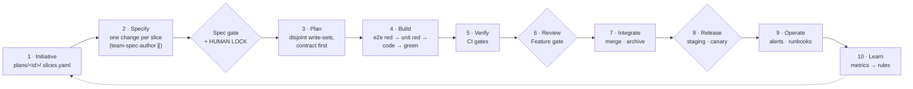
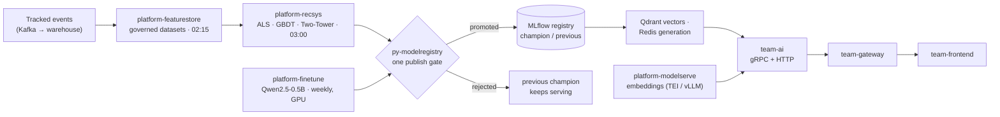

# Agora — an ASDLC for scaling a polyrepo with AI agents

**Agora is a working reference for an _Agentic Software Development Life Cycle_ (ASDLC v2).**
It is a standard for letting AI coding agents build and maintain a large multi-service system
without the system drifting, breaking its own rules, or passing tests that prove nothing.

The marketplace itself (25 bounded contexts: Go gRPC services, a Next.js storefront, Kafka/CQRS,
and a real AI layer: an LLM assistant with RAG, recommenders retrained every night, an LLM
fine-tune pipeline, all behind one model registry and one publish gate) is the **testbed**. It is
big and coupled enough that unstructured "prompt and hope" development fails quickly. What this
repository shows is the lifecycle, the gates and the evidence that keep agent output correct as it scales.

| | |
|---|---|
| Bounded contexts coordinated | **25** (`team-*` services, `platform-*` platforms), one git repository |
| Commits | **1451**, of which **1263** are agent co-authored |
| Requirement changes run through the lifecycle | **97** OpenSpec changes (96 archived) · **79** capability specs |
| Capabilities with a machine-readable contract | `FEATURES.yaml` acceptance coverage **1033/1040 automated (99%)** |
| End-to-end suite | **220** `.feature` files against the real stack (parallel lane + serial destructive lane) |
| Gates | **4** versioned question sets (`spec`, `task`, `feature`, `release`; 33 questions, each traced to a standard) · **9** CI jobs, 5 required on `main` |
| AI layer | **4** models in one MLflow registry (`recsys-als`, `recsys-gbdt`, `recsys-two-tower`, `finetune-classifier`) · **1** shared publish gate · LLM eval gate in CI |
| Guardrails | **16** skills · **11** sub-agents · **4** hooks · **17** ADRs |

Process source of truth: [`docs/asdlc/ASDLC-v2.md`](docs/asdlc/ASDLC-v2.md). One-page start:
[`docs/ONBOARDING.md`](docs/ONBOARDING.md). Plan and status: [`docs/asdlc/ASDLC-v2-PLAN.md`](docs/asdlc/ASDLC-v2-PLAN.md).

---

## 1. Why an ASDLC

Agents scale the **output** of engineering: more code, more services and more changes per day.
They do not scale **correctness** on their own. Without a lifecycle, a polyrepo fails in
predictable ways:

| Failure mode | What it looks like | Where ASDLC v2 stops it |
|---|---|---|
| Layer drift | A service exists but is missing from compose or the port map; a proto changed but consumers were not regenerated | `repo_doctor` (CI job `repo`) + the `drift-check` hook |
| Boundary violations | The frontend calls a service directly; a service reads another service's DB | `AGENTS.md` rules + `contract-boundary-reviewer`, routed by path glob |
| Contract forks | Generated code edited by hand to "make it compile" | `guard-generated` hook; `buf lint`/`breaking` (CI job `proto`) |
| Vague requirements | Specs that cannot be tested or contradict another team's change | EARS lint, Spec gate (ISO 29148), `cross_change_check`, **human lock** before build |
| Tests written to match the code | Green suites that were never red | Test author ≠ implementer (`guard-tests` hook) + **red-first proof** (CI job `tdd`) |
| Tests that test mocks | Green suites that never touch the system | `no_self_mock.py`; black-box e2e on the real stack |
| Reviewer fatigue | One LLM pass over a whole diff misses things | Per-question checklist gates, script first, LLM only for what is uncertain |
| Unproven releases | "Deployed" with no rollback ever tried | Release gate: canary with auto-abort, rollback drilled, alert route proven |

## 2. The lifecycle (10 phases)



| # | Phase | Artifact | Exit gate | How |
|---|---|---|---|---|
| 1 | Initiative | `plans/<id>/00-spec.md`, `slices.yaml` (owner, `depends_on`, `uses`/`provides`) | DAG acyclic, write-sets valid | skill `initiative-plan`, `validate_plan.py` |
| 2 | Specify | `openspec/changes/<slice>/` with NFR, Data classification, Threat model, EARS delta spec | strict validate, `spec_lint`, `cross_change_check`, Spec gate, **human signs `LOCK.md`** | `team-spec-author` ×N, `spec-quality-reviewer`, `spec-clarify` |
| 3 | Plan | code track per repo + e2e track | write-sets disjoint; a proto change lands first, alone | `validate_plan.py` |
| 4 | Build | e2e red → per task: unit red → code → green → e2e green | Task gate per task | skill `feature-run` (`e2e-author` → `test-author` → `implementer` → `task-reviewer`) |
| 5 | Verify | CI green | all jobs in `asdlc-gates.yml` | `scripts/asdlc/ci_local.sh` locally, GitHub Actions on PR |
| 6 | Review | decision table per `FEATURES.yaml` entry | Feature gate: no veto | `feature-reviewer` (+ `privacy-reviewer` when routing flags PII) |
| 7 | Integrate | branch merged, one fix = one commit, change archived | features-check + full e2e | human: merge, `openspec archive` |
| 8 | Release | commit-sha image tag, staging overlay, canary | Release gate (SRE PRR); rollback tried once | skill `release`, `make -C deploy release-tag gitops-push smoke-staging` |
| 9 | Operate | health, logs, alerts, runbooks | alert reaches the local receiver | `incident-triager` (read-only), [`docs/runbooks/`](docs/runbooks) |
| 10 | Learn | proposed `AGENTS.md` / ADR diffs from incidents and metrics | human approves | `scripts/asdlc/metrics.py` vs `metrics/baseline.json` |

**Red-first proof** (`scripts/asdlc/red_first.sh`, CI job `tdd`): new unit/integration tests are
copied onto the merge-base and must **fail** there, then **pass** at HEAD. For e2e the proof is
commit order: the `.feature`/steps commit must precede the first implementation commit.

## 3. Roles

The orchestrator is always the main session running a skill, because sub-agents cannot spawn
sub-agents. Each worker sees only what its role needs.

| Role | Sees | Cannot |
|---|---|---|
| Orchestrator (`initiative-plan`, `initiative-build`, `feature-run`, `spec-clarify`, `release`) | initiative, changes, worker results, decision tables | write production code or tests |
| `team-spec-author` (1 per slice) | initiative, its owner repo, proto | write outside `openspec/changes/<slice>/` |
| `spec-quality-reviewer` | the spec | see code |
| `e2e-author` | spec + `FEATURES.yaml` | see service code |
| `test-author` | spec + interfaces/proto | see the implementation |
| `implementer` (own worktree) | tests + code | **edit tests** (blocked by `guard-tests.sh`) |
| `task-reviewer`, `feature-reviewer`, `privacy-reviewer` | diff, scenarios, decision table | edit anything |
| `incident-triager` | logs, metrics, `kubectl get/describe` | change anything; proposes one runbook step |
| `contract-boundary-reviewer`, `auth-scope-reviewer` | diff | — (routed by path glob, not by an LLM) |

## 4. Gates and the decision engine

Each gate runs **script → Kev → `decide.py` → LLM reviewer → human**, and the decision table goes
into the PR.

- **Scripts first.** Anything a machine can check is a script: path-glob routing, write-sets,
  secrets, `buf breaking`, spec format (`spec_lint.py`), self-mocks (`no_self_mock.py`), red-first.
- **Checklist questions, not a free-form review.** `gates/<gate>.v<N>.yaml` holds closed
  questions (yes/no, choice, score), each with a `source:` in a published standard: ISO/IEC/IEEE
  29148 and EARS (spec), 29119-4 and test-smell catalogs (task/feature), OWASP ASVS 4.0.3,
  Decree 13/2023 (privacy), Google SRE PRR (release).
- **Kev** is a small local model that answers those questions per scenario; only uncertain
  questions escalate to an LLM. It runs in **advisory** mode until the A/B/C experiment in
  `scripts/asdlc/kev_eval/` gives precision/recall numbers.
- **`decide.py` applies fixed rules, never an average.** Precedence:
  `ENGINE_DOWN` > `BLOCK` (veto failed; `WOULD_BLOCK` in advisory) > `ESCALATE_LLM` > `FAIL` > `PASS`.
  Script routing adds `NEEDS_HUMAN` for auth, payment, PII and prod release; a pass never clears it.
  Infrastructure failure never blocks.

**CI** (`.github/workflows/asdlc-gates.yml`, mirrored locally by `scripts/asdlc/ci_local.sh`):

| Job | Checks | Required on `main` |
|---|---|---|
| `specs` | `openspec validate --strict`, `spec_lint`, scenario ↔ `FEATURES.yaml` cross-check on changed changes | yes |
| `features` | `features.py --strict` (manifests valid, every `covered_by` resolves) | yes |
| `repo` | `repo_doctor`, `asdlc_config --check`, `check_gates` | yes |
| `proto` | `buf lint`, `buf breaking` vs base | yes |
| `tests-asdlc` | unit tests of the ASDLC scripts, `no_self_mock` | yes |
| `tdd` | red-first proof (Go, Python) | no |
| `security` | gitleaks, Trivy (HIGH/CRITICAL), semgrep (advisory) | no |
| `mutation` | mutation testing; on `workflow_dispatch` or the `mutation` label, advisory | no |
| `security-review` | Claude security review on PRs, only when an `ANTHROPIC_API_KEY` secret exists | no |

Per-service CI (`services-ci.yml`) runs each service's own lint, tests and eval gate.

## 5. Parallelism model

Parallel agents are only useful if they do not collide:

1. **Initiative → slices.** One slice is one OpenSpec change with an owner repo. `cross_change_check`
   proves the slices agree (every RPC/event used is provided by a contract slice, one owner per
   scenario, no two slices edit one requirement) and prints the build order.
2. **Contract serialization.** Contract slices (`platform-core`) build first, sequentially; the
   rest build in waves with disjoint write-sets.
3. **Workspace isolation.** Each feature runs in its own git worktree and branch (`asdlc/<change>`).
4. **Track isolation.** Inside a change the e2e track and the code track are written by
   different agents from the same spec; the gate is the sync point.
5. **Runtime isolation.** Each checkout runs its own compose project; parallel e2e workers that
   touch shared stores get private namespaces.
6. **Resource hygiene.** Heavy environments a task does not need (the kind cluster) stay off
   during e2e.

## 6. Definition of Done

A change is done when **all** of these hold.

**Spec**
- [ ] Locked by a human (`plans/<id>/LOCK.md`, `status: approved`) before build started.
- [ ] Every user-facing `#### Scenario:` maps 1:1 to a `FEATURES.yaml` acceptance line and a
      `.feature` scenario; a wrong requirement is fixed by a `MODIFIED` delta via `spec-clarify`.

**Tests**
- [ ] Minimum tests per scenario type ([`docs/asdlc/ASDLC-v2.md` §7](docs/asdlc/ASDLC-v2.md)): e2e + unit for
      behaviour, contract test + `buf breaking` for proto, an attack probe for permissions,
      property tests for invariants, a real broker for Kafka, a black-box job + leakage check for ML.
- [ ] Red-first proven; tests written by someone other than the implementer.
- [ ] E2E runs against the real stack through the public edge; known gaps are
      `xfail(strict=True)` with a reason; every flake is root-caused.

**Gates**
- [ ] Task gate per task, Feature gate per change, all required CI jobs green.
- [ ] `NEEDS_HUMAN` items signed off by a human.

**Release** (when shipped)
- [ ] Image tagged by commit sha, staging smoke green, canary analysis passing, rollback drilled.

## 7. Human in the loop

| Decision | Owner |
|---|---|
| Lock the spec; answers to `spec-clarify` | Human (the build refuses without `LOCK.md`) |
| Scope trade-offs, product behaviour | Human (the agent proposes options with a recommendation) |
| Merge, push, `openspec archive`, branch protection | Human, per action |
| Prod release | Human, after staging smoke + canary |
| Destructive operations (volumes, clusters, force pushes) | Human; reversible alternatives offered first |
| Rule changes from Learn (`AGENTS.md`, ADRs, gate files) | Human |
| Secrets | Never in git; dev defaults only where overridable |

## 8. Evidence: what the lifecycle caught

| Practice | Defect it surfaced |
|---|---|
| Root-causing flakes instead of retrying | Kafka consumers in two services **silently stopped** on a fetch timeout; notifications and order events stopped flowing |
| Probing authorization through the edge | **IDOR**: any signed-in user could book a payout from any seller's wallet to their own bank account |
| Turning a strict `xfail` green instead of keeping it | Seven broken links in the recommender path, from a warehouse on `/tmp` to wrong vector ids |
| Replacing mock-based pipeline tests with black-box job runs | Unevaluable runs were still promoted; gate decisions were not auditable |
| Auditing metrics, not just tests | **Data leakage** in offline evaluation: ndcg@10 went from 0.75 (leaky) to 0.08 (honest) |
| Live release drill (W4) | Smoke tests pointed at the wrong host; `gitops-push` silently skipped same-size files; a bad canary was auto-aborted in ~100 s |
| Red-first in CI | Tests added after the code (green at base) are reported instead of counted as proof |

Baseline before v2 (from git history, `docs/asdlc/baseline.md`): median change cycle time 9.6 h,
p90 477 h. `metrics.py` reports against it.

## 9. The testbed

An AI-first marketplace (Shopee-like). `platform-core` owns the gRPC contract, infrastructure
and ADRs; each `team-*` directory owns exactly one bounded context and its own database.
Browsers reach services only through `team-gateway`. Write-side services publish Kafka events
through a transactional outbox, and read-side services build projections (CQRS). Deployment is
local GitOps: kind + ArgoCD + Argo Rollouts, fed from a local Gitea (`deploy/`, `platform-gitops/`).

- Architecture: [`platform-core/docs/ARCHITECTURE.md`](platform-core/docs/ARCHITECTURE.md) · Decisions: [`platform-core/docs/ADR/`](platform-core/docs/ADR)
- Repository map, ports and rules: [`AGENTS.md`](AGENTS.md) · Ownership: [`CODEOWNERS`](CODEOWNERS)

### The AI layer

The AI layer is more than a demo: it trains on its own schedule, gates every model before it is
served, and degrades safely when a dependency fails.



| Part | What it does |
|---|---|
| [`team-ai`](team-ai/README.md) | Shopping assistant, magic listing, chat copilot, tag classifier, streaming chat, recommendations, listing search. LLM calls go through a LangChain router (`CHAT_BACKEND=llm_router`, model + fallback chain, any LangChain provider); `mock` is the offline default. RAG with LlamaIndex over Qdrant, fed by a Kafka listing indexer. Langfuse + OpenTelemetry tracing, per-principal rate limit and reply quota, scope-gated gRPC. An eval gate (`run_eval --min-score 0.8`) runs in CI. |
| [`platform-recsys`](platform-recsys/README.md) | Nightly job: trains ALS, a GBDT ranker and a Two-Tower model on a leakage-free holdout, submits each to the gate, publishes only promoted models (Qdrant vectors, Redis generation pointer). team-ai serves the new generation with no code change. |
| [`platform-finetune`](platform-finetune/README.md) | LLM fine-tune pipeline (full, LoRA, QLoRA, QAT): ingest → validate → train → evaluate (calibration, confidence intervals) → gate. Weekly on one GPU; also a GPU perf toolkit that binds every tuned config to the GPU it was measured on. |
| [`platform-modelserve`](platform-modelserve/README.md) | Inference router in front of TEI / vLLM: embedding cache, in-flight limit with 429 backpressure. |
| [`platform-featurestore`](platform-featurestore/README.md) | Materializes governed training datasets (offline snapshot + online Redis copy). |
| `py-modelregistry` (`platform-core/packages/`) | The one gate ([ADR-0017](platform-core/docs/ADR/0017-unified-model-registry-and-publish-gate.md)): per-model policy in one file (primary metric, minimum relative improvement, guard ratios, floors), two-phase evaluate → publish → apply, fail-closed when the registry is down, `promote --force --reason` and `rollback` for operators. |

## 10. Using the lifecycle

```bash
PY=platform-e2e/.venv/bin/python

# 1-2  Initiative and specs (Claude Code skills); stops for the human lock
/initiative-plan <id>
openspec validate <slice> --strict
$PY scripts/asdlc/spec_lint.py <slice>
$PY scripts/asdlc/cross_change_check.py --slices plans/<id>/slices.yaml

# 4-6  Build after plans/<id>/LOCK.md is approved; one feature at a time: /feature-run <change>
/initiative-build <id>
scripts/asdlc/red_first.sh --base origin/main
scripts/asdlc/ci_local.sh                           # same jobs as CI (--docker-tools for gitleaks/trivy)
make -C platform-e2e spec-check CHANGE=<change>

# Run the system the tests run against
docker compose up -d --build

# Train, gate and roll back models (MLflow UI on :5050)
docker compose --profile jobs run --rm platform-recsys      # or platform-finetune (CPU locally)
python -m modelregistry promote <model> <version> --force --reason "<text>"
python -m modelregistry rollback <model>

# 8-9  Release to local staging, roll back
make -C deploy cluster-up
make -C deploy release-tag TAG=<sha> RELEASE_ENV=staging
make -C deploy gitops-push smoke-staging
scripts/rollback.sh <service> --env staging --to <sha>

# 7    Archive (human)
openspec archive <change>
```

## 11. Known gaps

- **Kev is not live yet.** Gates run their scripts and LLM reviewers; Kev latency and the
  A/B/C experiment are pending, so all gates stay advisory.
- **`tdd` and `security` are not required checks.** Red-first fails on dependency bumps and
  pre-existing tests; Trivy's secret scan flags the committed dev JWT key (kept as a dev fixture,
  refused in strict environments).
- **E2E is a local gate.** The full stack does not fit a hosted runner; CI runs everything else.
- **`feature-run` has not yet been exercised end to end on a new feature.**
- **AI layer:** the `finetune-classifier` champion has no consumer yet, and the finetune serving
  files are not ported. Locally, model serving uses `tei-fake` (no real TEI or vLLM in compose),
  and team-ai chat defaults to the `mock` backend until an LLM provider is configured.
- Plan status per task: [`docs/asdlc/ASDLC-v2-PLAN.md`](docs/asdlc/ASDLC-v2-PLAN.md) §7.
