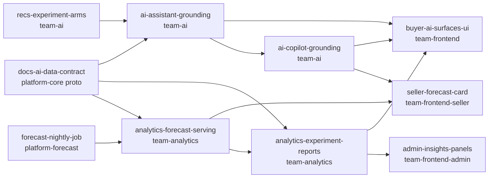

## Summary

Initiative `docs-ai-data`: 10 OpenSpec slices that put real data behind the AI and analytics surfaces (seller demand forecast, recs experiment arms, grounded assistant and copilot, admin insight reports). Plan and lock: `plans/docs-ai-data/` (LOCK re-approved 2026-11-16, all 10 digests match).

**Archived in this PR:** all 10 OpenSpec changes, in LOCK.md build order, moved to `openspec/changes/archive/2026-11-17-<slice>/` and folded into `openspec/specs/` (no separate archive PR). New capabilities: `docs-ai-data-contract`, `demand-forecast-job`, `analytics-demand-forecast`, `analytics-experiment-reports`, `admin-insights-panels`, `recs-experiment-arms`, `ai-assistant-grounding`, `ai-copilot-grounding`, `buyer-ai-surfaces-ui`, `seller-demand-forecast-card`, `seller-magic-listing-provenance` (each with a written Purpose). Updated capabilities: `recs-serving-safeguards` and `recsys-generations` (1 MODIFIED each), `ai-assistant` (1 REMOVED), `ai-interaction-events` (1 ADDED, 1 MODIFIED, 1 REMOVED). team-ai FEATURES.yaml acceptance refs now point at `openspec/specs/recs-experiment-arms/spec.md`; the per-slice packets in `plans/docs-ai-data/wave*.md` keep their historical `openspec/changes/<slice>` paths, as earlier archived initiatives do.



Data path of the seller forecast:

```text
forecast-job (nightly, python -m forecast run)
  read order_facts.parquet (analytics export volume, read-only)
  fit / select model per listing -> p10/p50/p90
  write Redis DB 3  fc:v1:seller:<seller_id>:<listing_id>  (TTL 48 h) + fc:v1:meta
team-analytics GetDemandForecast
  validate ids -> one Redis read (FORECAST_READ_TIMEOUT_MS)
  no key -> is_cold_start; bad/slow store -> Unavailable
  reorder_point / safety_stock from P50/P90 over lead time
team-gateway -> team-frontend-seller ForecastCard
```

Contract additions (`platform-core/packages/proto`):

```diff
 service AnalyticsQueryService {
   rpc GetDemandForecast(...)
+  rpc GetRetentionCohorts(...)
+  rpc GetExperimentReadout(...)
+  rpc GetAiSurfaceReport(...)
 }
 platform/ai/v1/ai.proto
+  provenance fields (request_id, model_version) on assistant / copilot replies
```

Per repo:

```text
platform-core/        ai.proto, analytics.proto, compat tests, ADR-0013 status
platform-forecast/    nightly LightGBM/baseline job -> Redis DB 3 (new compose service forecast-job, gitops CronJob 45 2 * * *)
team-analytics/       forecaststore (go-redis), GetDemandForecast, retention / readout / AI-surface reports
team-ai/              Flipt experiment arms on home_feed, tier/ranker/arm in model_version,
                      assistant grounded on search + GetListing, copilot grounded on listing stock
team-gateway/         admin procedures for the 3 reports, exposure beacon policy, analytics forwarding
team-frontend/        assistant chat + home block + review summary provenance, experiment exposure beacon
team-frontend-seller/ ForecastCard on /seller/analytics, Magic Listing provenance beacons
team-frontend-admin/  retention, experiments, placements, AI-surface panels on /admin/cockpit
fe-platform/          api-client regenerated (analytics), changeset; apps re-vendor the tarball
platform-e2e/         56 e2e files: features, steps, recsys/forecast fixtures
```

## Evidence

- **Before:** e2e suite written red first per slice (`test(e2e): <slice> red` commits); FEATURES entries `planned`.
  **After:** 70 FEATURES entries flipped to `automated` after their scenarios passed on env `docs-ai-data`; renamed modules re-ran green (2 + 33 passed, b881d721f).
- **rgp module, fresh env `docs-ai-data` with the tooling PR's `agora_env.py` (2026-11-16):** `up --with platform-recsys,mlflow`, recsys seed only from `up` (1440/1440 events, export confirmed).
  `test_rgp_generation_publish.py`: **7 passed, 0 failed, 0 errors**; teardown `restore_real_generation` clean. Decision 8 (recsys seed shape) is proven. Before the tooling fixes the same module had 7 failed + 1 error (mlflow `NoSuchBucket`: `minio-init` was not started).
- **era module, earlier run (2026-11-16):** 8 passed, 1 failed (`test_flipt_unreachable_serves_the_default_ranker_as_unassigned`): on a fresh env no published listing existed when `up` seeded, so `in_stock_only` dropped every synthetic id. Fixed in 0a9630251: the scenario publishes its own stock-5 listing and puts it in the serving generation (restored in teardown); assertions and spec.md unchanged.
- **E2E re-run 2026-11-17, fresh env `docs-ai-data` with the tooling PR's `agora_env.py`, no `--with`:** the tooling auto-added platform-recsys and mlflow (plus postgres-mlflow, minio) from the slices; recsys seed export confirmed (120 visitors). `test_era_experiment_arms.py` + `test_rgp_generation_publish.py` (HEADLESS=true): **16 passed, 0 failed, 0 skipped**. The env was taken down afterwards (no containers, volumes, networks or state left). Two env `up` attempts failed first for environment reasons handled in the tooling PR (migrate jobs racing a fresh postgres initdb; OrbStack daemon crash during the 21-image rebuild); the passing `up` reused the images built from unchanged source.
- **Tooling commits moved out of this branch (2026-11-16):** 529796f42 (red_first BSR remote-plugin drop) reverted in 33079bafc; the `agora_env.py` `FLIPT_CONTAINER` hunk of c44c42977 reverted in 06ab26afa; the `services-ci.yml` platform-forecast job of 5849c3d81 reverted in c879164f6. All three now live in `chore/asdlc-tooling`. Feature code from c44c42977 and 5849c3d81 stays here.
- **Local CI (base 06c44c17, head c879164f6, re-run 2026-11-16 after the reverts). After the archive (head d5eadf9f1 and again at the PR-body commit, 2026-11-17) `ci_local.sh specs features repo proto tests-asdlc` re-ran: all five PASS (tests-asdlc 223 passed).**

| check | result | evidence |
|---|---|---|
| ci_local specs (after archive, 2026-11-17) | pass | spec_sync --strict on all 10 archived changes ("e2e-ready to archive"), cross_change_check OK (resolves `openspec/changes/archive/<date>-<slice>`) |
| openspec validate --specs --strict (after archive) | pass for this branch | 154 passed, 53 failed; all 53 are main specs with the placeholder Purpose already on origin/main, none of the 15 capabilities this branch touches |
| ci_local specs | pass | openspec validate --strict, spec_lint (warnings only), spec_sync, cross_change_check |
| ci_local features | pass | `make -C platform-e2e features-check` |
| ci_local repo | pass | repo_doctor, validate_plan (known exceptions below), asdlc_config, check_gates |
| ci_local proto | pass | buf lint + buf breaking vs base |
| ci_local tests-asdlc | pass | pytest scripts/asdlc/tests, guard and red_first shell tests |
| ci_local tdd red_first (go, ts) | pass | 38 OK + 2 EXEMPT (trailers), every Go and TS test red at base and green at head |
| ci_local tdd red_first (python) | tooling red, green once chore/asdlc-tooling merges | 33 team-ai / platform-forecast files "red at head": run with the platform-e2e venv, which lacks their deps; same suites green with their own venvs (rows below). Fixed by the tooling PR (decision 16) |
| ci_local tdd red_first e2e order | tooling red, green once chore/asdlc-tooling merges | first impl commit 2f9e3f1e (vendored proto copies) precedes the first e2e commit 62c45323; is_contract widening is decision 10 |
| ci_local security | not run | gitleaks / trivy not installed locally |
| team-ai ruff format, ruff check, check_env_example | pass | 322 files formatted, all checks passed, .env.example in sync |
| team-ai pytest + coverage | pass | 1292 passed, coverage 96.69% (gate 80%) |
| team-ai eval gate | pass | 7 cases, 5 scored, pass_rate 1.0, 2 judge cases skipped |
| team-ai core-only import | pass | `uv sync --frozen --no-dev` + `import main` |
| team-ai pyright | pre-existing red | 2 errors in tests/unit/transport/test_search_servicer.py:267,282 (file and deps untouched by this branch) |
| team-ai real Redis tests | not run | needs a Redis on localhost:6379 (CI service container) |
| platform-forecast pytest | pass | 22 passed |
| Go team-analytics, team-gateway, team-domain, team-order | pass | go vet + go test |
| Go team-search | pass (db-tests skipped) | 65 skipped Docker-backed tests; only a proto copy changed |
| Go team-notification | pre-existing red | TestDockerRequiredNeverSkips needs GO_SDK_REQUIRE_DOCKER; only a proto copy changed |
| Go platform-core/packages/proto | pre-existing red | checkout_compat_test.go:162 pin 17 vs 18 (decision 11, other branch), audit catalogue heading (25 vs 17), Q6Gate tests need a local `main` ref; none of these protos are touched here |
| team-frontend, -seller, -admin | pass | npm ci, proto, check (biome, tsc, tokens, vitest), build |
| fe-platform | pass | check (incl. vendor:check), template build, release:status |
| platform-gitops unittest | pass | 111 tests OK |

## Merge Danger

**Door:** two-way

Additive proto fields and RPCs (buf breaking passes), new optional env vars with safe defaults (empty `FORECAST_REDIS_URL` -> `Unavailable`, empty `RECS_FLIPT_URL` -> experiments off, `ASSISTANT_BACKEND` / `COPILOT_BACKEND` default `mock`). Reverting the merge restores the old behaviour; Redis DB 3 keys expire after 48 h.

**Blast Radius:** cross-service

- Recs `model_version` format changes to `<model_version>/<tier>/<ranker>/<arm>`; any consumer that parses it (analytics, dashboards) sees the new shape.
- team-ai now depends on team-search and team-domain at boot (compose `depends_on`) and needs a service principal with `listing.read` and `search:read` in every environment.
- Assistant reply streaming route `POST /api/assistant/stream` is removed from team-frontend.
- The three apps re-vendor `fe-platform-api-client.tgz`; a stale tarball breaks their build.
- Hot file shared with the seller-centre / trust-legal PRs: `docker-compose.services.yaml`.
- `openspec/specs/**`: no capability directory this branch touches is touched by the seller-centre, monetization or trust-legal branches, so the archive adds no spec merge conflict. `scripts/asdlc/cross_change_check.py` and its test carry the same content as dc30a7b5d on `asdlc/seller-centre` (the archive-dir resolver), so they merge cleanly either way. Trial merges still conflict on FEATURES.yaml, READMEs, `package-lock.json` and the vendored api-client tarball (pre-existing, not from the archive).
- `scripts/asdlc/red_first.sh`, `scripts/devenv/agora_env.py` and `.github/workflows/services-ci.yml` are back to `origin/main` on this branch; their changes ship in the tooling PR.

**Merge order:** `chore/asdlc-tooling` first, then this PR. Until the tooling PR lands: the services-ci platform-forecast job does not exist (`openspec/changes/archive/2026-11-17-forecast-nightly-job` task 1.8 and `openspec/specs/demand-forecast-job` still name it), `flipt_flow.py` falls back to container `agora-flipt-1` without the `FLIPT_CONTAINER` export, red_first can hit unauthenticated BSR rate limits, and the two tdd rows above stay red.

## Needs human

### E2E decisions
- Resolved: the ERA fresh-env failure (option a, 0a9630251) and the rgp `--with` question (the tooling PR now adds platform-recsys and mlflow from the slices); both modules green on 2026-11-17.
- Postgres healthcheck in `docker-compose.yaml` (`pg_isready -U postgres` passes during initdb on the unix socket); `pg_isready -h 127.0.0.1 -U postgres` would remove the migrate-job race at the source. Product compose config, your call.

### Deploy order
1. platform-core contract (proto) and fe-platform api-client release.
2. platform-forecast job (Redis DB 3, CronJob after the analytics export) — confirm DB 3 is free (LOCK open issue 1).
3. team-analytics with `FORECAST_REDIS_URL` / `FORECAST_READ_TIMEOUT_MS`.
4. team-ai with `RECS_FLIPT_URL`, `RECS_EXPERIMENT_SALT` (required outside dev/local/test), `ASSISTANT_LISTING_ADDR`, and the `listing.read` + `search:read` principal accepted by team-domain and team-search.
5. Flipt flag `recs-home-feed-ranker` per environment (only the local seed script creates it).
6. team-gateway, then team-frontend, team-frontend-seller, team-frontend-admin.

### Privacy / DPO (from LOCK.md and the slices' design.md)
- U6 consent basis: aggregate reports count all first-party events without `consent_analytics` filtering (contract, reports, recs entity hash, admin panels, seller beacons).
- Experiment readouts have no small-sample suppression threshold; admin-only access and aggregate shape are the only mitigation.
- Retention cohorts anchor on authenticated user ids only; anonymous sign-ups fall outside every cohort.
- Beacon retention and consent basis for `impressionId` / `modelVersion`.
- Recs experiment assignment sends user / anonymous ids to Flipt only as a salted SHA-256 hash; salt management per environment.
- Anonymous visitors get no flag variant (server-readable anonymous-id cookie would raise a consent and Secure-cookie question).

### Red-First-Exempt commits (review the reasons)
- 0f80611a5 team-frontend/src/features/assistant/actions.test.ts — regression guard
- e5bfe33cd seller-forecast-card guest/no-scope guard tests green at base
- 67ad44fed seller-forecast-card FEATURES.yaml metadata only
- 8e4256143 admin-insights-panels formatting only
- 08cc7ddff analytics-experiment-reports lint/format only
- aa74dc4c5 team-gateway/internal/edge/analytics_test.go — wrong int64 JSON expectation corrected
- b87cafaef team-ai test_flag_trim.py, test_team_ai_runtime.py — follow config
- 751ab9dd7 team-ai test_golden.py — follows the new factory signature
- 7baa0907c platform-forecast test_forecast_pipeline.py — regression guard

### LOCK re-approvals
- Batch re-approval 2026-11-16 (decision 5) covers all 10 slices; digests verified at this head (the tooling reverts and docs sync touch no `openspec/` file). "Known exceptions" (decision 9) is already recorded; no JVM stubs are part of this initiative. Two scenario titles were renamed (ai-copilot-grounding, admin-insights-panels) to match one FEATURES manifest.

### Accepted exceptions (plans/docs-ai-data/LOCK.md "Known exceptions")
- validate_plan wave 4/5/6 widened conflicts (decision 9): the `widened (P1)` bullet was parsed as a write-set entry; widened paths do not overlap within a wave. Parser fix in the tooling PR.
- decide.py was ENGINE_DOWN for every slice; spec verdicts are the spec-quality-reviewer's checklist.

### Open spec questions
- LOCK.md "Open issues / NEEDS_HUMAN" items 1-42 (Redis DB 3, new deps go-redis / lightgbm / duckdb, cold-start shape, report limits, recs tier list and fallback `model_version`, copilot claims and impersonation, admin 403 UX) remain for confirmation.

🤖 Generated with [Claude Code](https://claude.com/claude-code)
