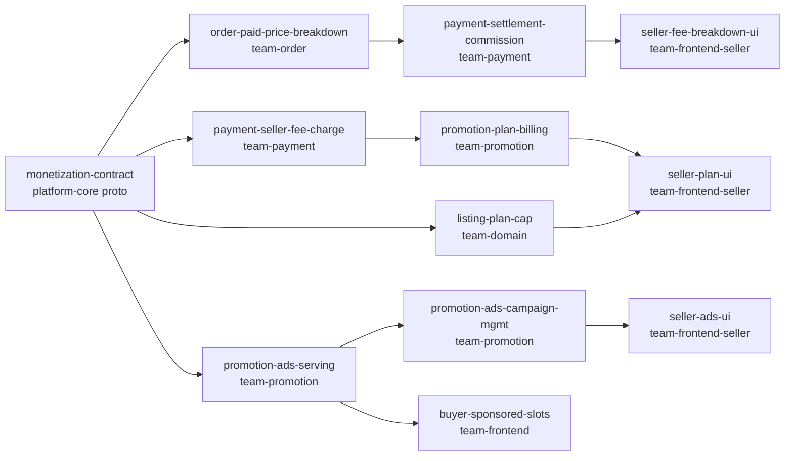

## Summary

Monetization initiative: 12 locked OpenSpec slices (commission on sales, paid seller plans, sponsored ads), built test-first on `asdlc/monetization`. 179 commits, 346 files. No `scripts/` file differs from origin/main any more: the red_first edit moved to the tooling PR (chore/asdlc-tooling).



Money flows after this PR:

```text
order paid (team-order)
  OrderPaidEvent + price breakdown (fields 9-12)
    team-payment settlement
      credit seller  ORDER_SETTLEMENT  +gross
      debit          COMMISSION        -rate (COMMISSION_RATE_BPS)
      on refund      COMMISSION_REVERSAL
    GetOrderSettlement -> seller order page "Phí & quyết toán"

seller plan (team-promotion SubscriptionService)
  Subscribe / renewal sweeper
    team-payment ChargeSellerFee (service-only, payment:write)
      SUBSCRIPTION_FEE -price, once per reference_id
  GetEntitlements -> team-domain CreateListing cap (PLAN_LISTING_LIMIT)
                                UpsertStorefront featured cap (PLAN_FEATURED_LIMIT)

sponsored ads (team-promotion SponsoredService)
  ListSponsoredSlots(search|home) -> impression_token (ad_impressions, purged after 30 days)
  RecordAdClick(token)            -> charge bid once, PAUSED_BUDGET when spent
  ListMyAdCampaigns / Pause / Resume -> seller /seller/ads
```

| repo | files | lines | what |
|---|---|---|---|
| platform-core | 10 | +1885 -6 | order/payment/promotion proto additions, compat guards |
| team-promotion | 56 | +7032 -140 | plan billing + renewal sweeper, ad serving/click charge, campaign mgmt; migrations 0009, 0010 |
| team-payment | 38 | +4057 -47 | commission at settlement, ChargeSellerFee, GetOrderSettlement; migrations 0018, 0019 |
| team-domain | 28 | +2329 -13 | listing and featured caps from entitlements |
| team-order | 9 | +755 -8 | breakdown on OrderPaidEvent via outbox |
| team-gateway | 13 | +856 -5 | forwarders for settlement, subscription, sponsored RPCs |
| team-frontend-seller | 41 | +3544 -111 | /seller/plans, /seller/ads, settlement card, ledger labels |
| team-frontend | 23 | +1309 -11 | "Tài trợ" slots on search and home, /api/ads/click beacon |
| fe-platform | 4 | +338 -1 | api-client regenerated (minor changeset) |
| team-analytics, chat, engagement, notification, referral, search, frontend-admin | 18 | vendored proto copies (+ admin api-client tgz) |
| platform-e2e | 42 | +2757 -4 | features + steps for all 12 slices |
| docker-compose.services.yaml | 1 | +4 | UPSTREAM_PROMOTION_ADDR (team-domain), UPSTREAM_PAYMENT_ADDR (team-promotion) |

## Evidence

**Before:** on origin/main none of these behaviours exist; every slice's e2e and unit tests were committed red first (`test(e2e): <slice> red`, `test(<slice>/Tn): red`). red_first at head: 64 Go + 24 TS test files `red@base=yes green@head=yes`, the rest exempt with trailers (see Needs human).

**After:**

- e2e, converge (2026-11-16): 78/78 monetization scenarios green.
- e2e re-run of the 7 modules holding the 22 scenarios renamed in converge, fresh env `monetization`: 30/30 passed after the fix. First run 26/30; failing then: `tests/e2e/step_definitions/test_seller.py::test_seller_creates_a_new_listing[chromium]`, `::test_a_saved_listing_shows_a_success_toast_and_a_link_to_the_list[chromium]`, `::test_eleventh_listing_on_free_shows_the_upgrade_cta[chromium]`, `::test_boundary_the_tenth_listing_is_accepted[chromium]` (category `cat-laptop` exists only in the old seed script; fixed in 8c7186437 to `cat-electronics`). No failing node ids in the final run.
- Local CI (`scripts/asdlc/ci_local.sh`, BASE = merge-base 06c44c17), 2026-11-16, re-run at 8050f711d for specs, features, repo, proto, tests-asdlc and tdd after the red_first revert and the LOCK re-approval (the commits since the last PR body touch only `scripts/asdlc` and `plans/monetization/LOCK.md`, so no service repo CI was re-run):

| check | result | evidence |
|---|---|---|
| specs | pass | openspec validate --strict, spec_lint (PERM warnings only, accepted in LOCK), spec_sync, cross_change_check |
| features | pass | `make -C platform-e2e features-check` |
| repo | pass | repo-doctor no drift; validate_plan 12 packets / 6 waves; check_gates OK |
| proto | pass | buf lint + buf breaking vs base |
| tests-asdlc | pass | pytest + guard + red_first self-tests ALL OK, with red_first.sh back at origin/main content |
| tdd: no_self_mock | pass | 0 findings in 28 files (earlier run) |
| tdd: red_first | fail, expected until the tooling PR merges | 64 Go + 24 TS tests: 75 `red@base=yes green@head=yes`, the rest EXEMPT by trailer or SKIP (no Test funcs); only red is e2e-order: first impl b2a9742b (vendored proto copies) before first e2e d7d6b7b6; fixed by chore/asdlc-tooling (decision 10) |
| security | not run | gitleaks, trivy, semgrep not installed |
| Go vet+test team-order, team-domain, team-gateway, team-payment, team-promotion | pass | gate_digest go --vet: 0 failed, 0 skipped |
| Go test platform-core/packages/proto | 4 fail, not this branch | `TestWriteAuditEventRequest_Comment_*` fails identically on origin/main; 3 `TestQ6Gate_*` need a local `main` branch and gitignored `platform-core/gen` (environment) |
| team-frontend-seller | pass | npm ci, proto, check (biome, tsc, tokens, vitest 126 files / 1049 tests), build |
| team-frontend | pass | same; vitest 267 files / 2252 tests, build |
| team-frontend-admin | pass | same; vitest 85 files / 877 tests, build |
| fe-platform | pass | npm run check (incl. vendor:check), template build, release:status (api-client minor) |
| consumer proto copies | pass | `monetization_consumer_copies_test.sh`: 14 repos build, buf lint, buf breaking |

## Merge Danger

**Door:** one-way

Four forward migrations change data on deploy: team-payment 0018/0019 widen the `wallet_ledger` type/sign CHECK (SUBSCRIPTION_FEE, COMMISSION, COMMISSION_REVERSAL); team-promotion 0009 sets existing campaigns with `bid < 500` or `budget < bid` to ENDED, 0010 adds plan billing (grandfathered ACTIVE paid rows get one free 30-day term). Once commission and fee rows are written to seller wallets, rolling back the binaries leaves ledger rows the old code does not know.

**Blast Radius:** money

- Every paid order now books a commission debit on the seller wallet; refunds book a reversal.
- team-domain `CreateListing` and `UpsertStorefront` now depend on team-promotion `GetEntitlements` and fail closed when it is unreachable or misconfigured: a promotion outage blocks listing creation.
- Seller plan charges and renewals debit wallets through `ChargeSellerFee`; the scope name must match on both sides.
- `RecordAdClick` is public (no scope) and charges the bid; rate limit is the gateway edge default.
- Merge order: the tooling PR (chore/asdlc-tooling) first. It carries the red_first BSR remote-plugin fix that was reverted here (468e2b956) and the e2e-order fix the tdd red above waits for; after the revert this branch no longer touches `scripts/asdlc/red_first.sh`, so the two PRs do not conflict there.
- Merge order with the other initiative PRs: all four re-vendor proto copies into the same team-*/proto paths; expect conflicts there and in fe-platform api-client generated files.

## Needs human

**Deploy order**

1. platform-core proto (contract only, additive).
2. team-payment with migrations 0018, 0019 (ChargeSellerFee, GetOrderSettlement, commission on settlement; accepts old-shape OrderPaidEvent).
3. team-order (publishes the breakdown).
4. team-promotion with migrations 0009, 0010 and `UPSTREAM_PAYMENT_ADDR`, `UPSTREAM_PAYMENT_TIMEOUT`, `SUBSCRIPTION_RENEWAL_RETRY_WINDOW`, `MIN_AD_BID`.
5. team-domain with `UPSTREAM_PROMOTION_ADDR` (required; caps fail closed).
6. team-gateway.
7. team-frontend-seller, team-frontend (and team-frontend-admin for the re-vendored api-client).

Staging/prod values for `COMMISSION_RATE_BPS` and the new upstream addresses are not set outside local compose.

**Privacy / DPO**

- promotion-plan-billing: 12-month retention of lapsed `seller_subscriptions` rows (proposal.md:91, :112) needs DPO sign-off.
- promotion-ads-serving / monetization-contract: `ad_impressions` stores an opaque token, campaign id, listing id and timestamps, no buyer id, IP or session; basis legitimate interest, purge after 30 days. Confirm the basis and window.
- promotion-ads-serving: the click self-check compares the forwarded principal with the campaign owner at request time; nothing is stored. Confirm no logging of the buyer principal is needed.
- seller-fee-breakdown-ui, seller-ads-ui, promotion-ads-campaign-mgmt: no buyer data; raw seller, order and listing ids are not logged (sloglint forbidden keys).

**Spec defaults still open** (LOCK.md "Open issues", built on the bracketed defaults): grandfathering, renewal retry window, scheduled downgrade without `pending_plan_id`, platform-voucher share on refunds, incoherent breakdown handling (team-order skip metric, team-payment DLQ), empty-category search slots, placement keys and forged tokens, budget rules and the ENDED migration, PAUSED_BUDGET terminal in v1, ChargeSellerFee `ALREADY_EXISTS` on reuse, featured cap reason `PLAN_FEATURED_LIMIT` and FREE = 0 featured, seller UI wording, anonymous click with expired session, RecordAdClick rate limit.

**Red-First-Exempt commits** (trailer count in brackets)

db4906ccf [2], 49052aaaf [2], 740784239 [1], 1cda4316c [1], c1158b718 [1], a56365cf3 [1], 04b5ee18f [2], 48386bfb7 [1], d21a2fa60 [1], d4e672dda [1], 8f82dc1a5 [1], 2fbc1fa0f [1], 44b094984 [1], 00f89bdcc [3], fa5a4ba03 [1, malformed, fixed forward by 00f89bdcc], 865cc46e4 [1], 2063220c7 [1]. Reasons: compat guards widened for the contract, formatting/fixture-only test edits, and guard scenarios already green at base.

**LOCK re-approvals**

All 12 slice digests changed at converge (VERIFIED BY citations, task ticks, renamed scenario names); LOCK.md shows old → new and every current digest matches (recomputed 2026-11-16). Re-approved 2026-11-16 as a batch re-approval after converge (decision 5, extended to monetization), recorded in LOCK.md in 8050f711d.

**Accepted exceptions** (LOCK.md "Known exceptions", decision 9)

- validate_plan wave 1: `platform-e2e/pyproject.toml` marker line shared by listing-plan-cap and promotion-ads-serving (ed4e25aba).
- validate_plan --audit does not parse "widened (P1)" `path — reason` entries.
- red_first e2e-order red from vendored proto copies: fixed by chore/asdlc-tooling, which must merge first.
- Pre-existing on main: `TestWriteAuditEventRequest_Comment_Scenarios_NamingRuleCatalogueAndAdminPathWording` in platform-core proto.

🤖 Generated with [Claude Code](https://claude.com/claude-code)
