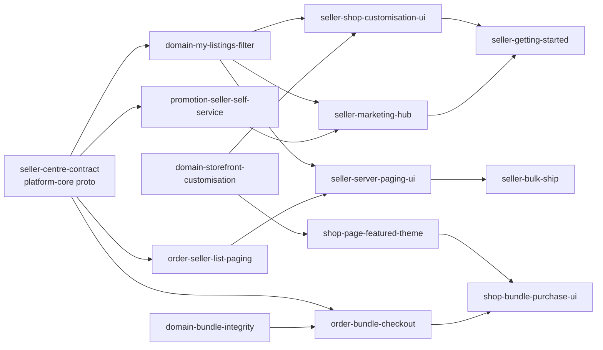

## Summary

Seller centre initiative: 14 OpenSpec slices that give a seller self-service shop tools (storefront look, filtered and paged lists, marketing hub, bundles, bulk shipping) and let buyers buy a bundle.



Contract (additive only, `platform-core/packages/proto`):

```diff
 service CartService {
+  rpc AddBundleToCart(AddBundleToCartRequest) returns (AddBundleToCartResponse);
 }
 CartItem / OrderItem
+  bundle_id, bundle_discount            // Cart: + bundle_discount_total
 ListSellerOrdersRequest
+  page, query, statuses                 // response: + page, status_counts
 ListMyListingsRequest
+  statuses, query
 service VoucherService {
+  rpc ListMyShopVouchers / DeactivateMyShopVoucher
 }
 service FlashSaleService {
+  rpc ListMyCampaigns / CancelMyCampaign
 }
```

Per repo:

```text
team-domain           storefront rules (tagline, banner bucket, featured <= 6, theme), ListMyListings filter, bundle integrity; migration 0017
team-order            AddBundleToCart + bundle pricing/untag at checkout (0025), seller order paging + status_counts (0026)
team-promotion        seller voucher/campaign self-service, flash_sale_campaigns.seller_id (0009) + backfill-campaign-sellers
team-gateway          forwards AddBundleToCart and the four seller promotion RPCs (auth only; services enforce listing.write)
team-frontend-seller  /seller/shop, /seller/marketing, getting-started card, server-paged products and orders, bulk ship, /seller/orders/print
team-frontend         shop page featured block + theme, bundle purchase in cart/checkout
fe-platform           api-client regenerated (changeset), re-vendored into every app
team-* proto copies   synced from platform-core
```

## Evidence

- **Before:** the slices' e2e were red on main (feature-run red commits, e.g. `test(e2e): seller-bulk-ship red` fc38466db).
  **After:**
  - Storefront customisation e2e: 8/8 passed (final). The first run of `test_storefront_customisation.py` failed 2 on the env port (`::test_banner_from_the_upload_bucket_is_saved[chromium]`, `::test_resending_current_values_keeps_all_fields[chromium]`); both passed after the storage port fix. Final failing node ids: none.
  - Seller e2e (`test_seller.py`): 30/30 passed after the fix (first run 26/30: `::test_seller_creates_a_new_listing`, `::test_a_saved_listing_shows_a_success_toast_and_a_link_to_the_list`, `::test_eleventh_listing_on_free_shows_the_upgrade_cta`, `::test_boundary_the_tenth_listing_is_accepted`). Final failing node ids: none.
  - Onboarding re-run passed for seller-marketing-hub (64b2fcbaf).
- Local CI on `origin/main..HEAD` (2026-11-16, `scripts/asdlc/ci_local.sh`, through gate_digest):

  | check | result |
  |---|---|
  | specs (validate --strict, spec_lint, spec_sync, cross_change_check) | pass |
  | features (features-check) | pass |
  | repo (repo_doctor, validate_plan, asdlc_config, check_gates) | pass |
  | proto (buf lint + breaking vs base) | pass |
  | tests-asdlc | pass |
  | tdd (red_first go,python + no_self_mock) | pass |
  | security (gitleaks, trivy, semgrep) | not run: tools not installed |
  | Go vet+test: team-domain, team-gateway, team-order, team-promotion | pass |
  | Go test platform-core/packages/proto | 4 fails, none from this branch (see below) |
  | fe-platform check + template build + release:status | pass (436 tests) |
  | team-frontend / -seller / -admin: proto, check, build | pass (2287 / 1184 / 877 tests) |
  | team-ai: env-example, pytest cov 96.7%, eval | pass (1121 tests, eval pass_rate 1.0) |
  | team-ai pyright | 2 errors in untouched `tests/unit/transport/test_search_servicer.py` (`_Metadatum` typing) |
  | docker build of the three apps | not run locally (no Dockerfile change) |

  platform-core proto test fails, not caused by this branch: `TestWriteAuditEventRequest_Comment_..._AdminPathWording` and `TestQ6Gate_NewSymbolsInEveryGeneratedLanguage` fail the same way on `origin/main` (audit catalogue count; no `gen/jvm`). `TestQ6Gate_ChangeIsBackwardCompatible` / `_WireBreakingEditIsRejected` default to a local `main` ref that this checkout lacks; with `Q6_BASE_REF=origin/main` both pass.

## Merge Danger

**Door:** one-way for data, two-way for code.

Migrations add columns and indexes only (`team-domain` 0017, `team-order` 0025 and 0026 `CREATE INDEX CONCURRENTLY`, `team-promotion` 0009). 0025 replaces the cart unique key with one that includes `bundle_id`; its down migration deletes bundle-tagged cart lines. Proto changes are additive (buf breaking passes).

**Blast Radius:** wide.

Touches cart and checkout pricing (bundle discount in totals), the seller order and listing lists, promotion authz on new seller RPCs, and every consumer's proto copy and vendored api-client. A wrong bundle allocation changes what buyers pay.

Deploy order:
1. platform-core contract, then consumers (proto copies and api-client are already in this PR).
2. Run migrations before the new images: team-domain 0017, team-order 0025 then 0026 (CONCURRENTLY: not inside a transaction-wrapped runner), team-promotion 0009.
3. team-promotion `backfill-campaign-sellers` once per environment after 0009; until then legacy campaigns (`seller_id = ''`) do not appear in the seller hub.
4. Back ends (team-domain, team-order, team-promotion, team-gateway) before team-frontend and team-frontend-seller.

## Needs human

- **Privacy / DPO.** Confirm the data classification in the slices' proposals:
  - seller-bulk-ship: `/seller/orders/print` renders buyer shipping name, phone and address for up to 50 orders. The basis is contract and the app keeps no copy. Should printed slips have a retention or audit rule?
  - domain-storefront-customisation: the shop tagline is public free text and may hold personal data the seller chooses to publish.
  - domain-my-listings-filter and order-seller-list-paging: the search `query` is request-scoped and never stored or logged.
  - promotion-seller-self-service: `flash_sale_campaigns.seller_id` is a pseudonymous id; the backfill logs counts only.
- **Production config:** if prod serves banners from a CDN host, that host must join the allowed `STORAGE_PUBLIC_BASE_URL` prefix (domain-storefront-customisation).
- **Deploy order** above, including the one-off backfill.
- **Red-First-Exempt commits** to review: 35 trailers in 31 commits. Among them:
  - 7337dd3b6: pin OrderService at 18 RPCs (decision 11).
  - 5766f18e1: fixture-only guard edits in platform-core promotion tests and team-frontend cart tests.
  - 7842f37e4: shell proto-copy test that red_first does not recognise.
  - Regression-guard e2e commits for domain-my-listings-filter, order-seller-list-paging, promotion-seller-self-service, order-bundle-checkout, shop-page-featured-theme, seller-shop-customisation-ui and seller-marketing-hub.
  - Formatting-only and slice-gate commits.

  List them with `git log origin/main..HEAD --grep Red-First-Exempt`.
- **LOCK re-approvals:** all 14 slice digests were batch re-approved on 2026-11-16 (decision 5, `plans/seller-centre/LOCK.md` "Re-approval 2026-11-16"). In seller-marketing-hub the buyer-without-`listing.write` scenario changed wording (08809f85f). In order-seller-list-paging the migration was renumbered 0025 to 0026.
- **Accepted exceptions** (`plans/seller-centre/LOCK.md` "Known exceptions", decision 9): validate_plan reported same-wave conflicts from the literal `widened` token in waves 1, 2, 4 and 5. No slice wrote another slice's files. validate_plan passes since f0d7b6ea4; the parser fix goes in the tooling PR.
- **seller-centre-contract task 3.2** is still unticked. Go, Python and TS are generated in `platform-core/gen`. JVM cannot be generated locally because no protoc java/kotlin or grpc-java plugin is installed (decision 13).
- **Renamed scenarios** (decision 14): before merge, re-run on each env the modules of the 7 renamed seller-centre scenarios.
- **Open spec questions** carried from `plans/seller-centre/LOCK.md` "Open issues": bundle money semantics, the bundle + flash-sale price, seller-side bundle rendering (no owner), ListMyListings page size, theme palette design approval and the bulk-ship selection scope.

🤖 Generated with [Claude Code](https://claude.com/claude-code)
