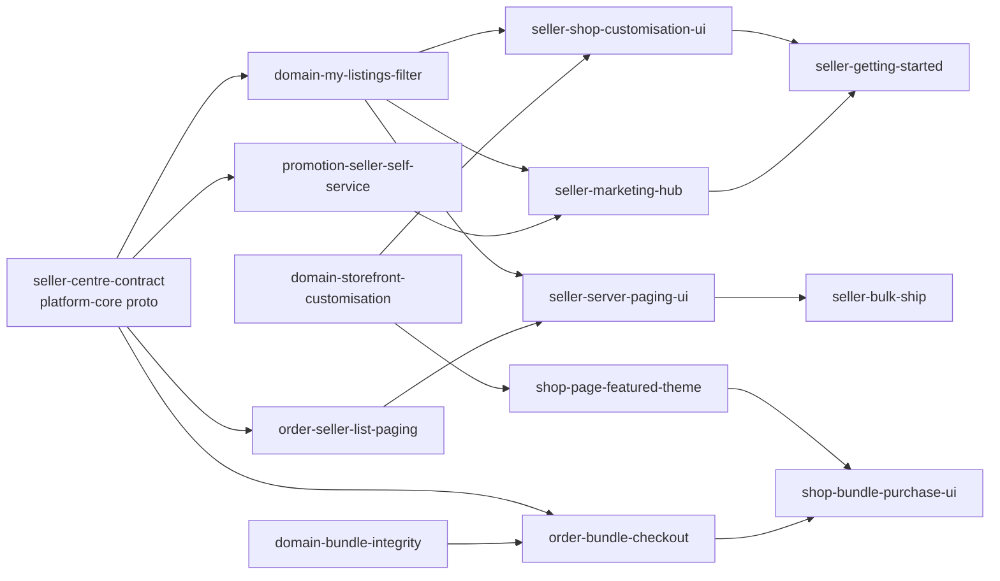

## Summary

Seller centre initiative: 14 OpenSpec slices that give a seller self-service shop tools (storefront look, filtered and paged lists, marketing hub, bundles, bulk shipping) and let buyers buy a bundle.



Contract (additive only, `platform-core/packages/proto`):

```diff
 service CartService {
+  rpc AddBundleToCart(AddBundleToCartRequest) returns (AddBundleToCartResponse);
 }
 CartItem / OrderItem
+  bundle_id, bundle_discount            // Cart: + bundle_discount_total
 ListSellerOrdersRequest
+  page, query, statuses                 // response: + page, status_counts
 ListMyListingsRequest
+  statuses, query
 service VoucherService {
+  rpc ListMyShopVouchers / DeactivateMyShopVoucher
 }
 service FlashSaleService {
+  rpc ListMyCampaigns / CancelMyCampaign
 }
```

Per repo:

```text
team-domain           storefront rules (tagline, banner bucket, featured <= 6, theme), ListMyListings filter, bundle integrity; migration 0017
team-order            AddBundleToCart + bundle pricing/untag at checkout (0025), seller order paging + status_counts (0026)
team-promotion        seller voucher/campaign self-service, flash_sale_campaigns.seller_id (0009) + backfill-campaign-sellers
team-gateway          forwards AddBundleToCart and the four seller promotion RPCs (auth only; services enforce listing.write)
team-frontend-seller  /seller/shop, /seller/marketing, getting-started card, server-paged products and orders, bulk ship, /seller/orders/print
team-frontend         shop page featured block + theme, bundle purchase in cart/checkout
fe-platform           api-client regenerated (changeset), re-vendored into every app
team-* proto copies   synced from platform-core
```

## OpenSpec archive

This PR archives all 14 OpenSpec changes of the initiative (7f4eea783), in LOCK build order, to `openspec/changes/archive/2026-11-17-<slice>`. Every delta was ADDED-only, so the archive creates 14 new capabilities under `openspec/specs/` and modifies no existing one: `seller-centre-contract`, `listing-bundle-integrity`, `listing-my-listings-filter`, `storefront-customisation`, `order-bundle-checkout`, `order-seller-list-paging`, `promotion-seller-self-service`, `seller-marketing-hub`, `seller-server-paging-ui`, `seller-bulk-ship`, `seller-shop-customisation-ui`, `seller-getting-started`, `ui-shop-storefront`, `ui-shop-bundle-purchase`. Each got a written Purpose (the archive placeholder fails `--strict`). Spec references in `team-frontend/FEATURES.yaml`, the platform-e2e feature headers and the task packets point at the archived paths. `cross_change_check` resolves archived slices via `a4bda1148` in the tooling PR (chore/asdlc-tooling); with that checker every slice of this initiative resolves (OK, same build order). `specs` is green once the tooling PR merges.

None of these 14 capabilities is touched by the open monetization, trust-legal or docs-ai-data branches, so merging the initiative PRs one after another has no `openspec/specs` conflict with this one.

## Evidence

- **Before:** the slices' e2e were red on main (feature-run red commits, e.g. `test(e2e): seller-bulk-ship red` fc38466db).
  **After:**
  - Storefront customisation e2e on a fresh `seller-centre` feature env (2026-11-16, `agora_env.py up` with the slices and this worktree as src, HEADLESS, through gate_digest, no scratch overlay): `test_storefront_customisation.py` 5/5 passed. The first run had 3 passed and 2 failed (`::test_banner_from_the_upload_bucket_is_saved[chromium]`, `::test_resending_current_values_keeps_all_fields[chromium]`, ConnectError on the presigned banner PUT): the env had no minio because the tooling closure did not follow team-domain's `STORAGE_ENDPOINT` code default. The fix is tooling commit ed43f718c (tooling PR), not code on this branch. Final failing node ids: none. `agora_env.py down seller-centre` left no containers, volumes, networks or images.
  - Seller e2e (`test_seller.py`): 30/30 passed after the fix (first run 26/30: `::test_seller_creates_a_new_listing`, `::test_a_saved_listing_shows_a_success_toast_and_a_link_to_the_list`, `::test_eleventh_listing_on_free_shows_the_upgrade_cta`, `::test_boundary_the_tenth_listing_is_accepted`). Final failing node ids: none.
  - Onboarding re-run passed for seller-marketing-hub (64b2fcbaf).
- E2E this round (2026-11-17): no seller-centre e2e ran; the round's env runs were for docs-ai-data and trust-legal only.
- Local CI after the archive (2026-11-17, `BASE=06c44c17b scripts/asdlc/ci_local.sh specs features repo proto tests-asdlc` through buildlock): specs, features, repo, proto and tests-asdlc all pass. `openspec validate --specs --strict`: the 14 new capabilities pass; 53 older specs on `origin/main` fail strict (mostly archive Purpose placeholders) and none of them is touched by this branch.
- Local CI on `origin/main..HEAD` (2026-11-16, `BASE=06c44c17b scripts/asdlc/ci_local.sh specs features repo proto tests-asdlc tdd` through buildlock and gate_digest, re-run after 7ce81d4ba: all six pass; the per-repo rows are from the earlier finalize, because 7ce81d4ba touches only `tasks.md` and `LOCK.md`):

  | check | result |
  |---|---|
  | specs (validate --strict, spec_lint, spec_sync, cross_change_check) | pass |
  | features (features-check) | pass |
  | repo (repo_doctor, validate_plan, asdlc_config, check_gates) | pass |
  | proto (buf lint + breaking vs base) | pass |
  | tests-asdlc | pass |
  | tdd (red_first go,python + no_self_mock) | pass |
  | security (gitleaks, trivy, semgrep) | not run: tools not installed |
  | Go vet+test: team-domain, team-gateway, team-order, team-promotion | pass |
  | Go test platform-core/packages/proto | 4 fails, none from this branch (see below) |
  | fe-platform check + template build + release:status | pass (436 tests) |
  | team-frontend / -seller / -admin: proto, check, build | pass (2287 / 1184 / 877 tests) |
  | team-ai: env-example, pytest cov 96.7%, eval | pass (1121 tests, eval pass_rate 1.0) |
  | team-ai pyright | 2 errors in untouched `tests/unit/transport/test_search_servicer.py` (`_Metadatum` typing) |
  | docker build of the three apps | not run locally (no Dockerfile change) |

  platform-core proto test fails, not caused by this branch: `TestWriteAuditEventRequest_Comment_..._AdminPathWording` and `TestQ6Gate_NewSymbolsInEveryGeneratedLanguage` fail the same way on `origin/main` (audit catalogue count; no `gen/jvm`). `TestQ6Gate_ChangeIsBackwardCompatible` / `_WireBreakingEditIsRejected` default to a local `main` ref that this checkout lacks; with `Q6_BASE_REF=origin/main` both pass.

## Merge Danger

**Door:** one-way for data, two-way for code.

Migrations add columns and indexes only (`team-domain` 0017, `team-order` 0025 and 0026 `CREATE INDEX CONCURRENTLY`, `team-promotion` 0009). 0025 replaces the cart unique key with one that includes `bundle_id`; its down migration deletes bundle-tagged cart lines. Proto changes are additive (buf breaking passes).

**Blast Radius:** wide.

Touches cart and checkout pricing (bundle discount in totals), the seller order and listing lists, promotion authz on new seller RPCs, and every consumer's proto copy and vendored api-client. A wrong bundle allocation changes what buyers pay.

Deploy order:
1. platform-core contract, then consumers (proto copies and api-client are already in this PR).
2. Run migrations before the new images: team-domain 0017, team-order 0025 then 0026 (CONCURRENTLY: not inside a transaction-wrapped runner), team-promotion 0009.
3. team-promotion `backfill-campaign-sellers` once per environment after 0009; until then legacy campaigns (`seller_id = ''`) do not appear in the seller hub.
4. Back ends (team-domain, team-order, team-promotion, team-gateway) before team-frontend and team-frontend-seller.

## Needs human

- **Privacy / DPO.** Confirm the data classification in the slices' proposals:
  - seller-bulk-ship: `/seller/orders/print` renders buyer shipping name, phone and address for up to 50 orders. The basis is contract and the app keeps no copy. Should printed slips have a retention or audit rule?
  - domain-storefront-customisation: the shop tagline is public free text and may hold personal data the seller chooses to publish.
  - domain-my-listings-filter and order-seller-list-paging: the search `query` is request-scoped and never stored or logged.
  - promotion-seller-self-service: `flash_sale_campaigns.seller_id` is a pseudonymous id; the backfill logs counts only.
- **Production config:** if prod serves banners from a CDN host, that host must join the allowed `STORAGE_PUBLIC_BASE_URL` prefix (domain-storefront-customisation).
- **Deploy order** above, including the one-off backfill.
- **Red-First-Exempt commits** to review: 35 trailers in 31 commits. Among them:
  - 7337dd3b6: pin OrderService at 18 RPCs (decision 11).
  - 5766f18e1: fixture-only guard edits in platform-core promotion tests and team-frontend cart tests.
  - 7842f37e4: shell proto-copy test that red_first does not recognise.
  - Regression-guard e2e commits for domain-my-listings-filter, order-seller-list-paging, promotion-seller-self-service, order-bundle-checkout, shop-page-featured-theme, seller-shop-customisation-ui and seller-marketing-hub.
  - Formatting-only and slice-gate commits.

  List them with `git log origin/main..HEAD --grep Red-First-Exempt`.
- **LOCK re-approvals:** all 14 slice digests were batch re-approved on 2026-11-16 (decision 5, `plans/seller-centre/LOCK.md` "Re-approval 2026-11-16"). In seller-marketing-hub the buyer-without-`listing.write` scenario changed wording (08809f85f). In order-seller-list-paging the migration was renumbered 0025 to 0026.
- **Merge order: tooling PR (`chore/asdlc-tooling`) first.** This branch reverted its red_first BSR-plugin edit (9e7370c30), which now lives in the tooling PR together with the validate_plan `widened` parser fix and the agora_env feature-env fixes (env-specific e2e exports, code-default storage port, minio closure ed43f718c). Without it, red_first re-runs on contract slices can hit the BSR rate limit, and the storefront e2e cannot run on a feature env other than mainx.
- **Accepted exceptions** (`plans/seller-centre/LOCK.md` "Known exceptions", decision 9): validate_plan reported same-wave conflicts from the literal `widened` token in waves 1, 2, 4 and 5. No slice wrote another slice's files. validate_plan passes since f0d7b6ea4; the parser fix goes in the tooling PR.
- **seller-centre-contract task 3.2** is ticked (7ce81d4ba, decision 13; LOCK re-digest c4dff7b1698c -> 5cab20d26502 in "Re-digest 2026-11-16"). `platform-core/gen/jvm` (gitignored) was generated locally with protoc 28.3 and protoc-gen-grpc-kotlin 1.4.1; Java, Kotlin and grpc-kotlin outputs expose the new RPCs and fields. grpc-java 1.68.1 stubs (`*Grpc.java`) were not generated: its osx-aarch_64 artifact is an x86_64 binary and Rosetta is not installed, so the grpc-kotlin output refers to missing `*Grpc` classes and the JVM output was not compiled. Accepted on 2026-11-17 (`plans/seller-centre/LOCK.md` "Task 3.2 acceptance 2026-11-17"): `*Grpc.java` needs Rosetta/x86, `gen/` is gitignored, and CI/BSR generates it. protoc 28.3 has no published checksum and was verified over HTTPS only; its local sha256 is `92ceefda6a7293ec014e6ecac82d64719357145cb6fc2865badadeb5e62c0431`.
- **Renamed scenarios** (decision 14): before merge, re-run on each env the modules of the 7 renamed seller-centre scenarios.
- **Open spec questions** carried from `plans/seller-centre/LOCK.md` "Open issues": bundle money semantics, the bundle + flash-sale price, seller-side bundle rendering (no owner), ListMyListings page size, theme palette design approval and the bulk-ship selection scope.

🤖 Generated with [Claude Code](https://claude.com/claude-code)
