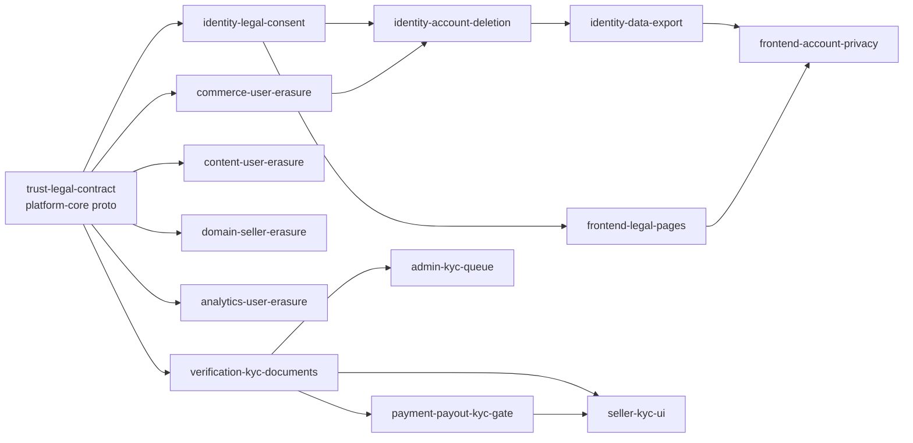
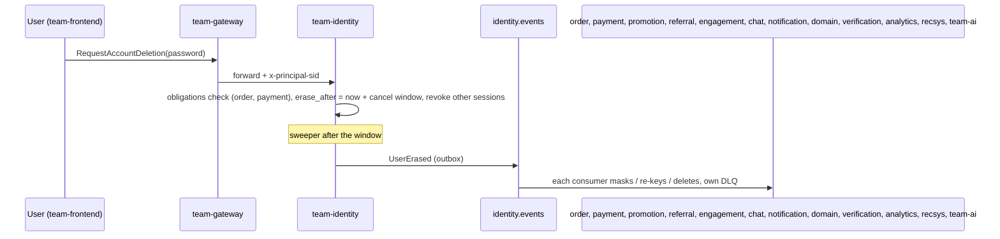

## Summary

Initiative `trust-legal` (backlog Q24): Terms/Privacy acceptance and a server-side consent ledger, account deletion with event-driven erasure in every store, data export, and real KYC documents with an admin queue and a payout gate. 14 OpenSpec changes, 236 commits, 651 files.



Contract (`platform-core/packages/proto`, copies vendored into consumers):

```diff
 service identity.v1
+  PrivacyService { RecordConsent, ListMyConsents, RequestAccountDeletion,
+                   CancelAccountDeletion, GetAccountDeletionStatus, ExportMyData }
+  event UserErased
 service order.v1      + GetUserObligations
 service payment.v1    + GetPayoutObligations
 service verification.v1
+  CreateKycUploadUrl, ListKycSubmissions, GetKycDocumentUrl, GetPublicBadges
```

Erasure flow:



| slice | owner | what lands |
|---|---|---|
| trust-legal-contract | platform-core | proto above, consumer copies, audit catalogue 25 -> 26 |
| identity-legal-consent | team-identity | migration `0022_consents`, Register requires legal versions, consent ledger RPCs |
| identity-account-deletion | team-identity | migration `0023_account_deletion`, request/cancel/status, sweeper, `UserErased` |
| identity-data-export | team-identity | `ExportMyData` JSON (capped, < 1 MiB) |
| commerce-user-erasure | team-order | obligations RPCs; order, payment, promotion, referral erasure consumers |
| content-user-erasure | team-engagement | reviews/Q&A re-key, chat and notification erasure |
| domain-seller-erasure | team-domain | seller listings suspended and scrubbed |
| analytics-user-erasure | team-analytics | warehouse re-key to pseudonym + HMAC tombstone; recsys, featurestore, team-ai consumers |
| verification-kyc-documents | team-verification | migration `002_kyc_documents`, MinIO presigned upload, retention sweep, public badges |
| payment-payout-kyc-gate | team-payment | payouts require `VERIFIED` KYC |
| frontend-legal-pages | team-frontend | seven legal pages, consent banner, re-acceptance prompt |
| frontend-account-privacy | team-frontend | consent history, export download, delete account |
| seller-kyc-ui | team-frontend-seller | document upload onboarding, payout step |
| admin-kyc-queue | team-frontend-admin | `?tab=kyc` review queue, audited document links |

## Evidence

- **Before:** no consent, deletion, export or document KYC exists on `main`; every trust-legal e2e scenario is red (`test(e2e): <slice> red` commits).
- **After:** 300/300 trust-legal e2e tests passed, combined from three passes: run 2 on the overlay stack passed 282/300; the 3 deletion-scheduling scenarios that refuse the short-window overlay passed in run 1 on the default stack; the 15 verification-kyc-documents scenarios lost to a docker daemon crash passed in a re-run of that module (43/46), and its 3 retention-sweep scenarios then passed (3/3) with `VERIFICATION_CONTAINER` set. No failing node ids remain. Gates at that point: features-check pass, `spec_sync --strict` pass, ci_local features+specs pass.

Local CI on `origin/main..HEAD` (2026-11-16, merge-base `06c44c17`), each through the build lock and `gate_digest.py`:

| check | result | evidence |
|---|---|---|
| ci_local specs | pass | openspec validate --strict, spec_lint, spec_sync, cross_change_check |
| ci_local features | pass | features-check, coverage 2182/2193 automated |
| ci_local repo | fail (accepted) | only `validate_plan` wave 2 conflict on `platform-e2e/pyproject.toml` (marker-only), a LOCK.md Known exception (decision 9); repo-doctor no drift |
| ci_local proto | pass | buf lint + buf breaking |
| ci_local tests-asdlc | pass | 221 passed, guard/red_first self-tests ok |
| ci_local tdd red_first | fail (not this branch) | e2e-order red from vendored proto copies (first impl `1974446a`): fixed by chore/asdlc-tooling (decision 10). Python tests "red at head" under the system interpreter (featurestore, recsys, team-ai erasure tests): decision 16 known limit, green below with per-repo venvs. All Go/TS tests red@base, green@head or EXEMPT |
| ci_local tdd no_self_mock | pass | 0 findings in 87 files |
| ci_local security | skipped | gitleaks/trivy not installed |
| Go `go vet` + `go test` (14 repos) | pass | analytics, audit, chat, domain, engagement, gateway, identity, notification (`GO_SDK_REQUIRE_DOCKER=1`), order, payment, promotion, referral, search, verification: 0 failed, 0 skipped |
| platform-recsys `make compile lint check-env test-host eval` (py3.10) | pass | 499 passed, 1 skipped; eval ok; erasure tests 19 passed |
| platform-featurestore pytest | pass | 102 passed |
| platform-featurestore ruff | fail (pre-existing) | 2 errors in `tests/test_hidden_review_exclusion.py`, not touched by this branch; changed files clean |
| team-ai pytest + eval | pass | 1134 passed; eval pass_rate 1.0 (`--env-file .env.example`, as CI) |
| team-frontend / -admin / -seller `npm ci, proto, check, build` | pass | biome + tsc + tokens + vitest + next build |
| frontend `docker build` | not run | image builds left to agora_env.py |

## Merge Danger

**Door:** one-way

Two forward-only identity migrations (`0022_consents`, `0023_account_deletion`) and one verification migration (`002_kyc_documents`). Erasure is irreversible by design: once a `UserErased` event is consumed, rows are masked, re-keyed or deleted by 12 Kafka consumers, plus the featurestore reconcile on its next `materialize` run.

**Blast Radius:** platform-wide

- Register now requires `terms_version`/`privacy_version` equal to `LEGAL_TERMS_VERSIONS`/`PRIVACY_POLICY_VERSIONS` (`2026-11`); an old client fails `INVALID_ARGUMENT`.
- Existing sellers without `VERIFIED` KYC can no longer request payouts (no grace period).
- The buyer `/account/verification` route is removed; KYC moves to the seller app.
- New consumer groups and DLQs on `identity.events` in 12 services; new MinIO bucket and `kyc-minio-init`.
- Deploy order: platform-core contract first, then identity and the erasure consumers, then verification and payment, then the frontends. Erasure consumers must be running before the identity sweeper emits the first `UserErased`.

## Needs human

- **Privacy / DPO** (LOCK.md section B, `00-spec.md` NEEDS_HUMAN, `verification-kyc-documents/design.md:31`): applicable law (Decree 13/2023 vs 2026 PDP law), the unverified "72 h" and Art. 16 citations; the text of all seven legal pages, the operator block and the KYC consent checkbox; accounting retention for pseudonymised orders/ledger/payouts and N years for consent records; KYC retention (VERIFIED documents deleted on `UserErased` vs kept); immutable team-audit copies after erasure; whether pseudonym re-keying counts as erasure (warehouse, reviews/Q&A, chat) and tombstone retention; disputes untouched by erasure; whether data export must be audited (a 27th audit action); retained ML artifacts and listing images of erased sellers.
- **Open product questions** carried from LOCK.md section A (items 1-23), e.g. obligations opened during the 48 h cancel window, KYC reject reason list and labels, deletion blocker text language.
- **Deploy order** as above; staging/prod need `ERASURE_TOMBSTONE_SECRET`, real MinIO credentials and SSE/KMS, bucket CORS for the seller-app origin.
- **Red-First-Exempt commits (28):** `cf9aceba5`, `3c4d0bb54`, `2c8ec0823`, `13843aae5`, `fb33fc25e`, `885221bc6`, `5ce78b91a`, `5a9e016d6`, `7e484756a`, `9c40777ac`, `ba1db4d2f`, `2b3c9266d`, `c821c4e6f`, `20d14826d`, `3b91be5f0`, `fe3b14d67`, `7b2b4b82e`, `969d03a2c`, `4b9fde1f3`, `e880b5b59`, `82616bc89`, `2fbda653f`, `1d06b88f9`, `e8107043d`, `d3442d51c`, `3a3cdc384`, `968d6008e`, `1974446ae`. Review each trailer's reason.
- **LOCK re-approvals:** all 14 slice digests changed after the 2026-11-13 lock; batch re-approved 2026-11-16 (decision 5) with one reason per slice in `plans/trust-legal/LOCK.md`.
- **Accepted exceptions:** validate_plan wave 2 `platform-e2e/pyproject.toml` marker-only conflict, and the wave 7/8 build-time widenings (LOCK.md Known exceptions, decision 9). The validate_plan parsing fix, red_first `is_contract` widening and per-repo venv interpreter land in the separate chore/asdlc-tooling PR.
- **Pre-existing reds not fixed here:** platform-featurestore ruff (2 errors in `tests/test_hidden_review_exclusion.py`).

🤖 Generated with [Claude Code](https://claude.com/claude-code)
